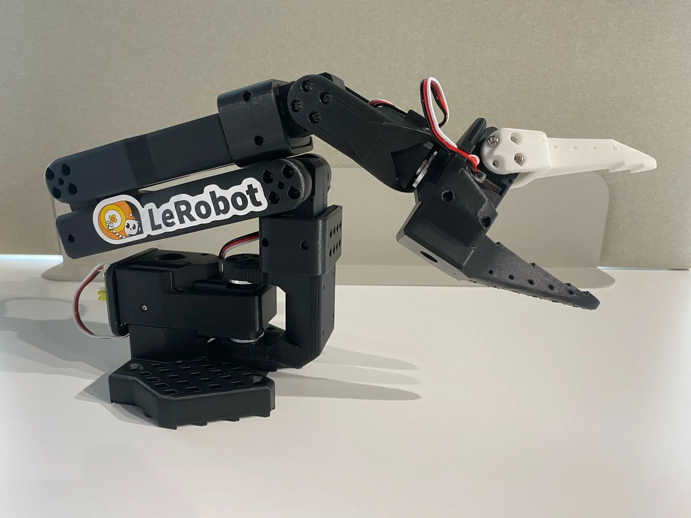

# LeRobot + SO-101：低成本桌面具身学习方案

[返回开源方案总览](../README.md) · [研究首页](../../README.md)

## 本轮报告

[完整产品调研](01_Product_Research.md)：市场定位、产品与软件架构、开源/许可边界、价格/包含项、国内海外生态、优势与限制、选型与实机验证建议。

## 来源与状态

- [官方来源及归档清单](REFERENCES.md)
- [可追溯来源与哈希](sources.json)
- [逐项价格口径](research_state/prices.json)
- [调研状态](research_state/progress.json)
- [归档和结构检查](research_state/archive_qa/01_Product_Research_quality.json)

部分网页静态依赖未取得，正文与原始响应保留；硬件性能、供应商库存和训练模型泛化尚未实机验证。
