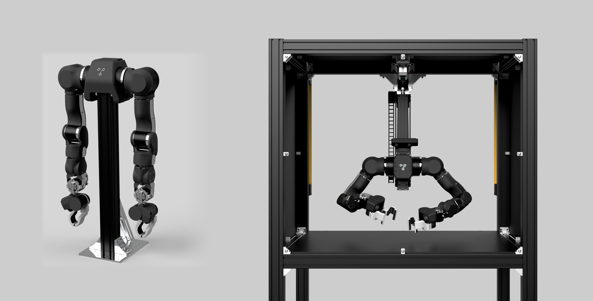

# OpenArm：开放硬件的接触操作与双臂科研平台

资料截止：2026-11-08（Asia/Shanghai）。产品级多维调研；main 分支内容以原件 SHA256 固定，论文实验与当前产品配置分别说明。

[本产品导航](README.md) · [开源方案总览](../README.md)

## 产品图片与版本

图源：[OpenArm_Cell_Photo](https://raw.githubusercontent.com/enactic/openarm/main/website/static/img/hardware/openarm_and_cell.png)。官方产品/设计资料，图片不构成性能验收证据。

## 市场定位与开发主体

OpenArm 由 Enactic 开发，官网说明实验室位于日本东京。项目将自己定位于 physical AI、接触丰富环境的研究与部署，公开仓库描述为七自由度、人类尺度、可反驱且具有柔顺性的机械臂。它在本研究中代表介于入门舵机臂与高价成套研究机器人之间的双臂平台。[OpenArm_Web](https://openarm.dev/)、[OpenArm_Hardware](https://raw.githubusercontent.com/enactic/openarm/main/README.md)。

定位并非“便宜工业机械臂”：核心价值是可修改硬件、遥操作与接触数据、以及统一评估环境。研究者可以检查机械、动力学与数据流程，但工业安全、全天候运行及售后属于另一个验收层级。官网关于安全与实用负载的措辞作为厂商宣称保留，不等价于经过认证的碰撞安全。

## 产品架构与版本边界

OpenArm 仓库把系统分成硬件 CAD/BOM、机器人描述、CAN 电机库、ROS2、MuJoCo、Isaac Lab、数据与遥操作等独立仓库。ROS2 部分连接 ros2_control 与 MoveIt，数据层提供 LeRobot 转换，仿真和真实数据流可在同一研究任务中分别验证。图中的机械臂与 Cell 是不同采购/配置单元，不能看见组合图就认为基础报价包含完整评估站。[OpenArm_Hardware](https://raw.githubusercontent.com/enactic/openarm/main/README.md)、[OpenArm_ROS2](https://raw.githubusercontent.com/enactic/openarm_ros2/main/README.md)。

当前资料已经包含 1.0、2.0 兼容性矩阵。MuJoCo 与若干基础库覆盖两个版本，但 Isaac Lab 的 2.0 标记为进行中，传统 teleop 的 2.0 状态也不是完全等同于 1.0；2.0 进一步使用 dora-rs 数据流。采购前应锁定硬件版本、描述文件、驱动和控制方式，不能混用旧装配指南和新推理配置。

Cell 的目的在于统一背景、灯光、相机和机械臂位置，使自动评估有可比条件。它能降低跨实验室场景差异，却不能保证任意场所都重现结果。KER 是同运动学的无电机示教装置；官网仍写有 forthcoming/不在本次 release，而仓库与采购目录已有 KER 资料与报价。这是发布状态差异，报告同时保留两条证据，不自行宣布所有版本均已交付。[OpenArm_Web](https://openarm.dev/)、[OpenArm_Hardware](https://raw.githubusercontent.com/enactic/openarm/main/README.md)、[OpenArm_Purchase](https://docs.openarm.dev/purchase)。

## 价格与供应商比较

官方采购目录最后更新于 2026-11-02，本轮于 11 月 8 日归档。下表是目录列价，不是询价成交，也不是所有商家同配置的性能对标。[OpenArm_Purchase](https://docs.openarm.dev/purchase)。

| 供应商/地区 | 版本或配置 | 列价 | 目录评价状态 | 交期记录 | 主要比较边界 |
| --- | --- | --- | --- | --- | --- |
| WowRobo，深圳 | V1.1 / V2 | USD 5,400 / 6,500 | Certified | 20–40天 | Cell与KER另价 |
| Cereboto，东莞 | V2无相机 / 有相机 | USD 6,280 / 7,080 | Evaluating | V2 14–30天 | 相机差价不能混作基础臂价 |
| Soma Robotics，上海 | 目录标准单位 | CNY 45,800；并列USD6,430 | Not evaluated | 14天 | 主要供中国大陆 |
| VLAI，深圳 | 目录列项 | USD 4,699 | Evaluating | 3–12天 | 版本/组件须进一步确认 |
| RT Corporation，东京 | OpenArm2及可选组件 | 询价 | Evaluating | 询价 | 主要服务日本 |
| Anvil，台北 | V2 | USD 5,600 | Not evaluated | 声称48小时内发货 | 现货状态需正式确认 |

目录脚注明确标准价格为带 follower 末端的一个单位，购买完整双臂研究站仍应让供应商写明左右臂、夹爪、相机、电脑、电源与 Cell 是否包含。项目 README 的“完整双臂6,500美元”提供参考，但不能代替每家实际配置表。[OpenArm_Hardware](https://raw.githubusercontent.com/enactic/openarm/main/README.md)。

Cell、KER、相机、VR 设备和训练计算资源不能静默包含在机械臂报价中。例如目录列 WowRobo Cell 6,200 美元、KER 2,599 美元，均应独立核对。合计方案前先确认它们是附加产品还是不同集成套装；本文未替用户下单或将报价直接相加成为完整工作站总成本。

## 国内与海外生态

OpenArm 是日本开发平台，但官方制造列表显著包含中国大陆供应商，并覆盖日本、台北和韩国等服务地域。这是开发主体、制造地点与市场服务分离的实例。国内团队能利用本地加工与中文服务；海外研究机构可以比较当地采购、跨境税费和返修安排。某供应商进入目录只证明被列入，不证明都获得官方认证。

目录设有 Certified、Evaluating、Not evaluated，并提示某些“OpenArmX Pro Max”名称当时不属于官方兼容项目。应核对版本及标识，不能只按商品名称或相似外观认定可复用开源软件。平台开放降低单一制造者锁定，但替代供应商的机械公差、电机参数与测试质量仍须验收。[OpenArm_Purchase](https://docs.openarm.dev/purchase)。

## 开源范围与许可

硬件仓库的实际 LICENSE.txt 是 CERN-OHL-S v2，属于强互惠硬件许可；代码/ROS2 的 Apache 2.0 是另一个层面。硬件声明中主源为 Google Drive，GitHub releases 只是镜像，资料包括 STEP、BOM、线路及不同版本的 Cell/KER 组件。仓库克隆成功不代表已下载全部 CAD 包，也不代表硬件与软件均可按同一宽松条款再发行。[OpenArm_Hardware_README](https://raw.githubusercontent.com/enactic/openarm_hardware/main/README.md)、[OpenArm_Hardware_LICENSE](https://raw.githubusercontent.com/enactic/openarm_hardware/main/LICENSE.txt)、[OpenArm_ROS2_LICENSE](https://raw.githubusercontent.com/enactic/openarm_ros2/main/LICENSE)。

对个人研究，开放 CAD 有利于修改结构；对制造商，分发衍生硬件时的完整源文件和通知义务必须按 CERN-OHL-S 检查。仿真引擎、模型权重和数据集采用各自条款。本文未取得每个数据集和每版固件的独立许可清单，不把“fully open-source”营销句子当成全供应链授权。

## 优势与限制的作用机制

七自由度和人类尺度有利于探索冗余姿态与接触操作，柔顺与反驱能支持较自然的示教。成立条件是动力学参数、关节摩擦和控制设置与硬件匹配；如果换电机或末端、改变载荷，原策略与重力补偿也需重验。Cell 的标准化价值在于减少环境变量，使性能差异更可能来自模型本身，而不是相机、灯光或机械臂安装差异。

限制一是版本仍演进，兼容矩阵不能被忽略。限制二是低列价不意味着低项目总成本：加工、相机、对齐、自动复位和运行监控仍需工程投入。限制三是没有共同测量条件的负载、精度与可靠性比较；本轮不声称它在工业协作、安全或全部模型性能上优于其他机械臂。

## 选型与PoC建议

若任务需要接触示教、可修改的双臂研究环境或统一评估站，OpenArm 值得进入候选；若只需第一次桌面学习，SO-101 的更低投入可能足够；若需要供应商对整个平台持续运行负责，则应增加整机服务与验收条款。

先用锁定版本完成驱动、零位、重力补偿和末端工具测试，再验证单臂与双臂的碰撞空间。对插接、擦拭等任务，应记录接触力或相应控制反馈、成功/失败、人工复位与连续运行表现。模型评估必须锁定 Cell 或相同布置，分别报告数据收集、策略推理、低层控制的频率，不能把 CAN 的频率当策略完成任务的速度。

## 资料与核验

[参考来源及本地原件清单](REFERENCES.md) · [机器可读来源](sources.json) · [价格记录](research_state/prices.json) · [核验结果](research_state/archive_qa/01_Product_Research_quality.json)

官网动态统计初始值为0，未作为规格；部分静态依赖缺失。CAD主包、硬件实测、所有权重/数据许可及供应商实际交付状态未完整验收。
