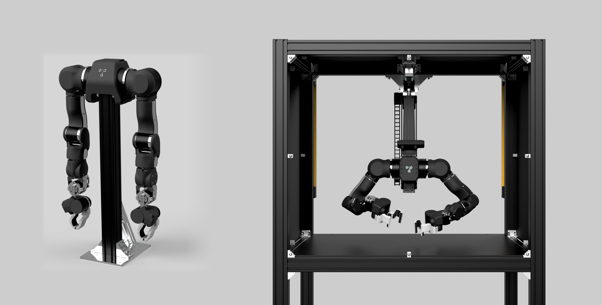

# OpenArm：开放硬件的接触操作与双臂科研平台

[返回开源方案总览](../README.md) · [研究首页](../../README.md)

## 本轮报告

[完整产品调研](01_Product_Research.md)：市场定位、产品与软件架构、开源/许可边界、价格/包含项、国内海外生态、优势与限制、选型与实机验证建议。

## 来源与状态

- [官方来源及归档清单](REFERENCES.md)
- [可追溯来源与哈希](sources.json)
- [逐项价格口径](research_state/prices.json)
- [调研状态](research_state/progress.json)
- [归档和结构检查](research_state/archive_qa/01_Product_Research_quality.json)

官网动态统计初始值为0，未作为规格；部分静态依赖缺失。CAD主包、硬件实测、所有权重/数据许可及供应商实际交付状态未完整验收。
