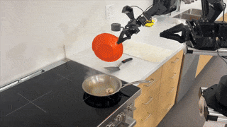
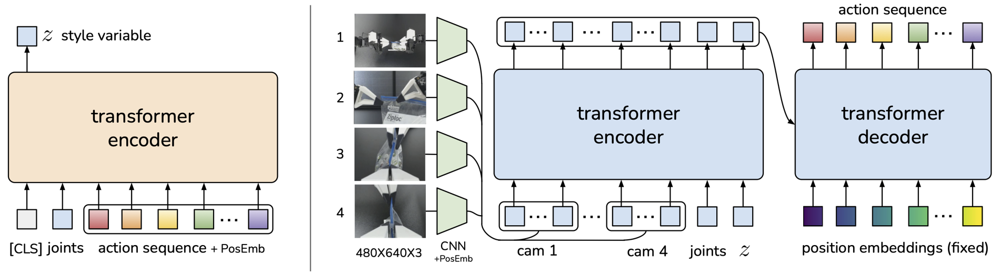

# ALOHA / Mobile ALOHA：双臂模仿学习与移动操作方案

资料截止：2026-11-08（Asia/Shanghai）。产品级多维调研；main 分支内容以原件 SHA256 固定，论文实验与当前产品配置分别说明。

[本产品导航](README.md) · [开源方案总览](../README.md)

## 产品图片与版本

图源：[Mobile_ALOHA_Preview](https://mobile-aloha.github.io/static/images/preview.gif)。原动画的单帧展示，不能据此判断完整运动质量。

## 市场定位与选入原因

ALOHA 是双臂遥操作硬件与数据采集系统，ACT 是与之关联的动作分块学习算法；Mobile ALOHA 则加入移动底盘与全身示教。论文项目提供硬件资料、训练代码和原型验证，因此适合作为“研究成果如何形成可重复具身实验”的代表。它们不是面向家庭用户的交钥匙家务机器人。[ALOHA_Web](https://tonyzhaozh.github.io/aloha/)、[Mobile_ALOHA_Web](https://mobile-aloha.github.io/)。

原始 ALOHA 项目标注 RSS 2023，Mobile ALOHA 的公开论文/项目属于2024年的研究。本文将其作为有代表性的技术方案，不将旧论文称为2026年最新商业型号。原作者平台、后续供应商套件和当前整机型号要分别记录，研究复现与采购决策因此可以共用资料而不混淆对象。

## 硬件结构和数据闭环

桌面 ALOHA 使用两套主从示教与执行臂，在原始环境中配四路RGB相机：两路固定、两路腕部。数据记录包含关节状态和动作，训练策略直接预测执行臂的关节命令。官方网页展示四路480×640图像，以及固定动作块长度和执行频率。数字描述的是特定实验配置，不是所有使用ACT的机器人都拥有的传感器和频率。[ALOHA_Web](https://tonyzhaozh.github.io/aloha/)、[ALOHA_README](https://raw.githubusercontent.com/tonyzhaozh/aloha/main/README.md)。

Mobile ALOHA 采用移动底盘、两执行臂、两示教臂、机载电池与计算机，操作者通过机械连接与示教臂同时引导底盘和手臂。论文说明自主运行时可以卸下示教结构，以减少尺寸与重量。移动使工作空间超出桌面，也增加相机观察变化、导航障碍、身体姿态和手臂接触的耦合。[Mobile_ALOHA_Paper](https://arxiv.org/pdf/2401.02117)。

论文中的底盘为 AgileX Tracer，体现美国研究项目与中国供应链组合。原型能做到升降高度范围65–200cm、臂伸出底盘约100cm、搬起1.5kg对象等论文描述，但本文不将这些数字外推到其他版本或新供应商整机。尤其是演示移动到柜子前再操作，不等于已经验证各种家庭布局。

## ACT与共同训练的机制

ACT 一次预测未来一段动作，减少每一步独立预测造成的误差累积，并通过时间聚合平滑执行。训练使用条件变分自编码器与Transformer；推理时处理视觉、关节等观测，输出动作块。这是一种从示范学习特定技能的机制，不具有仅凭自然语言就覆盖全部生活任务的保证。官方结构图保留在本地，不能用示意图代替模型精度测量。[ALOHA_Web](https://tonyzhaozh.github.io/aloha/)。

Mobile ALOHA 把静态操作数据与移动操作示范共同训练，项目网页称每任务50次示范时成功率提升最高可达90%。这个“提升”不能改写成所有任务绝对成功率90%，也不能忽略基线和任务差异。本文不据宣传摘要与不同平台做成功率排名；需要研究者按论文任务、数据划分和试验次数逐项复现。[Mobile_ALOHA_Web](https://mobile-aloha.github.io/)、[Mobile_ALOHA_Paper](https://arxiv.org/pdf/2401.02117)。

## 成本与当前采购信息

| 对象 | 公开金额 | 时间/性质 | 包含范围 | 不能推导的结论 | 来源 |
| --- | --- | --- | --- | --- | --- |
| 原始桌面ALOHA | 约USD20,000 | RSS2023研究平台预算 | 原作者双臂示教系统 | 2026整机成交价 | [ALOHA_Web](https://tonyzhaozh.github.io/aloha/) |
| 原始Mobile ALOHA | 约USD32,000 | 2024论文平台预算 | 包括机载电源与计算 | 安装运税/今日供应商价 | [Mobile_ALOHA_Paper](https://arxiv.org/pdf/2401.02117) |
| Tracer底盘 | USD7,000 | 论文所述美国市场成本 | 指论文底盘一项 | 国内底盘或当前报价 | [Mobile_ALOHA_Paper](https://arxiv.org/pdf/2401.02117) |
| Trossen后续AI系列 | 本轮未取得统一明确价格 | 2026-11-08实际页面 | 官网重新导向AI产品线 | 旧ALOHA价格可沿用 | [ALOHA_Trossen_Store](https://www.trossenrobotics.com/aloha.aspx) |

Mobile ALOHA 的32,000美元数字位于论文第一页图注和硬件说明，明确包含机载电源/计算。总预算不应再机械加上该论文中的7,000美元底盘价。若购买新型号，应从硬件代次、臂数、底盘、夹爪、相机、算力与示教设备重建配置清单。

本轮打开原始 ALOHA 指向的 Trossen 官方购买链接，页面已经显示“ALOHA IS NOW TROSSEN AI”，并介绍后续AI系列，而不是旧型号的直接价格表。这说明采购入口仍可定位供应商，但不能确认原型等价SKU正在销售。缺少实时整机价属于本文没有取得相应证据，不意味着厂商从未报价。

## 国内与海外使用路径

海外路径主要是作者资料、Trossen生态与研究社区；国内可结合原型图纸、国内底盘/加工供应商和本地科研团队复现。国内制造某些零件不能证明整套平台国产化，也不能把熟悉ROS等同于已经具有多臂同步能力。需要跨国采购时，应检查每个执行臂的电机、通信与维修渠道。

对国内机构，自建有利于掌握平台、替换供货和调整任务，但同时承担标定、布线和软件维护。海外机构购买服务完整的套件，可能以更高价格换取更快落地；本文没有共同条件的总成本数据，因此只比较作用机制，不断言哪条路线必然便宜。

## 开源内容与成熟度

ALOHA 数据记录代码的实际许可是MIT。硬件主要通过装配教程与商业部件组合，不能将MIT代码许可自动扩展到第三方机械臂、电机固件、所有图纸或训练数据。Mobile ALOHA 数据记录与训练代码分属仓库，数据集、权重和外部依赖必须再核对其条款。[ALOHA_LICENSE](https://raw.githubusercontent.com/tonyzhaozh/aloha/main/LICENSE)、[Mobile_ALOHA_README](https://raw.githubusercontent.com/MarkFzp/mobile-aloha/main/README.md)。

软件仍有复现门槛：ROS版本、依赖与硬件端口要按原型指南锁定。官方README明确警告关掉电机力矩后机械臂会倒塌，没有自动制动；因此“开源代码”与真实运行的机械安全必须一起看。这个行为直接影响装配、训练复位和演示场地安排，不能因为算法是开源而跳过。[ALOHA_README](https://raw.githubusercontent.com/tonyzhaozh/aloha/main/README.md)、[Mobile_ALOHA_README](https://raw.githubusercontent.com/MarkFzp/mobile-aloha/main/README.md)。

## 优势、限制与PoC建议

优势是双臂数据采集和动作学习有完整对应：既能追溯示教方式，也能分析失败来源。移动版本证明桌面示范可辅助部分移动技能，为数据复用提供研究价值。限制是体积、示教装置、接触误差、任务数据依赖和操作环境，厨务演示不能当作长期自主服务验证。

若目标是复现双臂学习论文或比较移动与静态共同训练，优先考虑此方案；只需低预算教学时，SO101/XLeRobot更易起步；需要高可靠执行则应增加供应商责任与持续运行测试。先在桌面验证ACT，再加入底盘，明确底盘命令与手臂动作时间对齐；用固定测试场景记录失败与人工干预。不要把自己采集的训练轨迹再当独立评估集，更不能把录像帧率当控制频率。

## 补充官方图表

图源：[ALOHA_Web](https://tonyzhaozh.github.io/aloha/resources/algo.png)。官方产品/设计资料，图片不构成性能验收证据。

## 资料与核验

[参考来源及本地原件清单](REFERENCES.md) · [机器可读来源](sources.json) · [价格记录](research_state/prices.json) · [核验结果](research_state/archive_qa/01_Product_Research_quality.json)

官方网页部分视频/静态依赖未取得；论文原件完整保存。未确认后续商业整机的当前报价，也未完成各数据集、权重和商业硬件的全项许可与实机验收。
