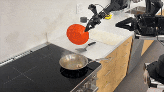

# ALOHA / Mobile ALOHA：双臂模仿学习与移动操作方案

[返回开源方案总览](../README.md) · [研究首页](../../README.md)

## 本轮报告

[完整产品调研](01_Product_Research.md)：市场定位、产品与软件架构、开源/许可边界、价格/包含项、国内海外生态、优势与限制、选型与实机验证建议。

## 来源与状态

- [官方来源及归档清单](REFERENCES.md)
- [可追溯来源与哈希](sources.json)
- [逐项价格口径](research_state/prices.json)
- [调研状态](research_state/progress.json)
- [归档和结构检查](research_state/archive_qa/01_Product_Research_quality.json)

官方网页部分视频/静态依赖未取得；论文原件完整保存。未确认后续商业整机的当前报价，也未完成各数据集、权重和商业硬件的全项许可与实机验收。
