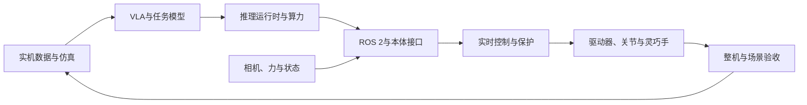

# 首轮全景研究结论

日期：2026-11-03。以下是公开资料首轮结论；136份文件已落位，关键商业和实测数据仍有缺口。

## 决策最有用的发现

1. NVIDIA公开的JetPack、Isaac与GR00T资料链较完整；Thor的2070TFLOPS是FP4稀疏，不能直接与RK3588的6TOPS或S100的80/128TOPS比较。Orin同页存在不同功率/软件配置数字，选型须锁定版本。
2. Intel提供π0.5的OpenVINO转换路径，但采样修改/随机张量MSE不能替代真实机器人任务验证；CPU样例不证明完整模型已在NPU运行。
3. RKNN/RKLLM的VLM示例与TROS的BPU封装是可核验工具能力；尚不足以宣称完整大型VLA及动作闭环已原生支持。国产模型与国产芯片适配必须逐模型举证。
4. Arm应作为IP/架构层；地平线汽车业务与D-Robotics机器人平台、海思与昇腾/华为云、服务器GPU与低功耗SOM分别评价。
5. Orbbec与RoboSense的公开驱动是较明确的硬件—软件关系；传统SDK不能自动覆盖所有新型号。减速器本身没有EtherCAT，驱动器/控制器才有通信接口。
6. G1 EDU可选Orin，而非G1全系标配；已公开SDK/模型不代表量产默认固件。各整机芯片BOM、自研/外采比例和2026交付/稼动数据大多未充分披露。
7. 模型代码、权重、数据和上游许可需分开。GO-1仓库数据与代码均有NC条款，OpenVLA也有Llama上游限制；Thinker开源状态尚未证实。
8. 具微科技、AGIROS、格物没有可靠公开定位，本轮按用户指示注明后跳过。Azure通用IoT/数字孪生、ModelArts通用AI服务不能未经证明写成完整具身专用套件。

## 候选路线（分析建议，非采购认证）

- 多相机、高自由度VLA/科研：先在NVIDIA GPU复现，按内存/温升/动作质量评估Thor或AGX Orin；原版7B OpenVLA不因低端模组TOPS高就自动可用。
- 已有工业x86系统：评估Intel Suite/OpenVINO与工业控制链，重点验证模型转换、实时调度和固件/蓝图组合。
- 国产端侧感知/轻策略：评估RDK S100/S100P、RK3588；大型VLA先完成算子和动作头PoC。
- 国产训练/边缘算力：将昇腾、MLU、MUSA分别测框架与模型；MLU220-SOM/M.2已有16/8TOPS INT8、15/8.25W规格，但现行供货与大型VLA需另外核验。
- Qualcomm高算力机器人：2026伙伴公告已确认IQ10/IRB10参考设计与星尘集成，进入PoC候选；700TOPS精度、最终接口、内存/瓦数与SDK待证。RB5只作历史移动视觉基线。

## 五层协同链

该图是通用架构，不代表任何厂商完整采用。具体已验证、可选与未知关系见[机器可读图谱](knowledge-graph.json)。

## 最小PoC验收口径

固定本体/关节/相机/固件、模型checkpoint、精度/动作空间、相机分辨率与数量、功率/温度及并发感知。记录采样到执行p50/p95/p99、峰值/持续功耗、热降频、成功/总次数、接管、恢复和故障类。先回放演示确认采集—执行一致，再测模型预测，最后实机闭环与长期运行。

## 阅读入口

- [20目录/136文件索引](README.md)
- [方法与证据规则](METHODOLOGY.md)
- [证据缺口与后续验证](GAPS_AND_NEXT_STEPS.md)
- [全部来源与内容状态](_Evidence/SOURCE_REGISTER.md)
- [结构/链接/哈希检查](validation.json)
